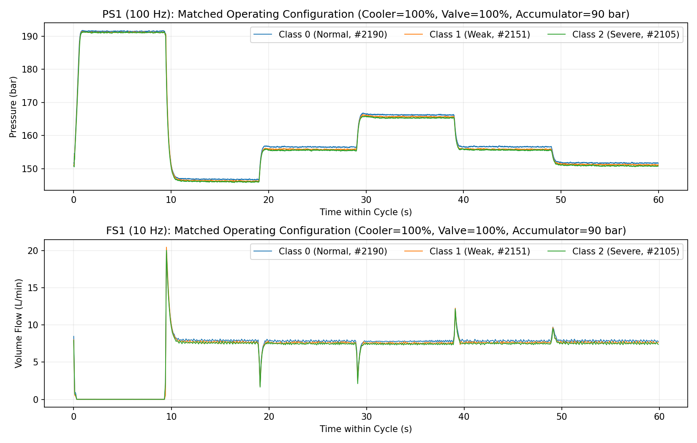
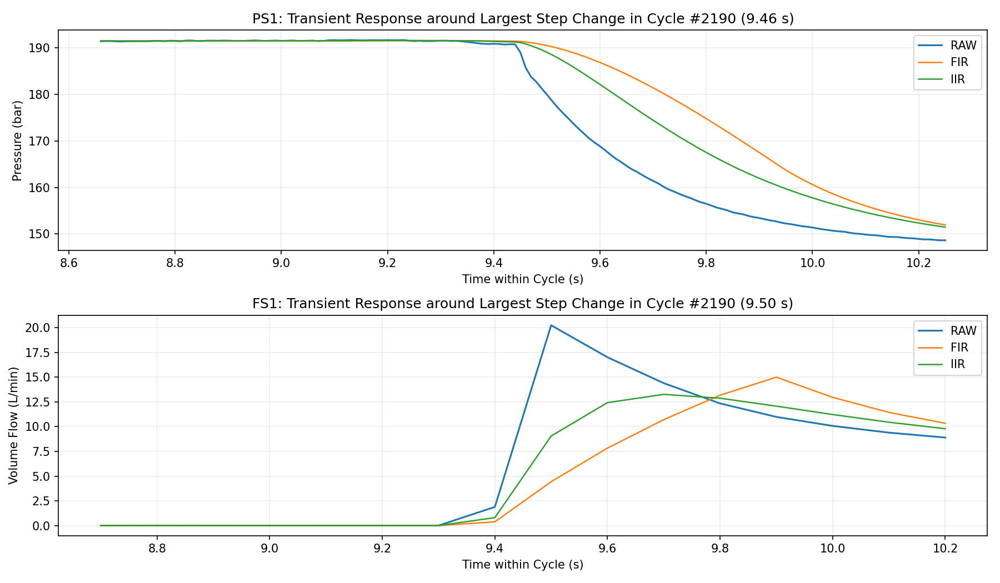
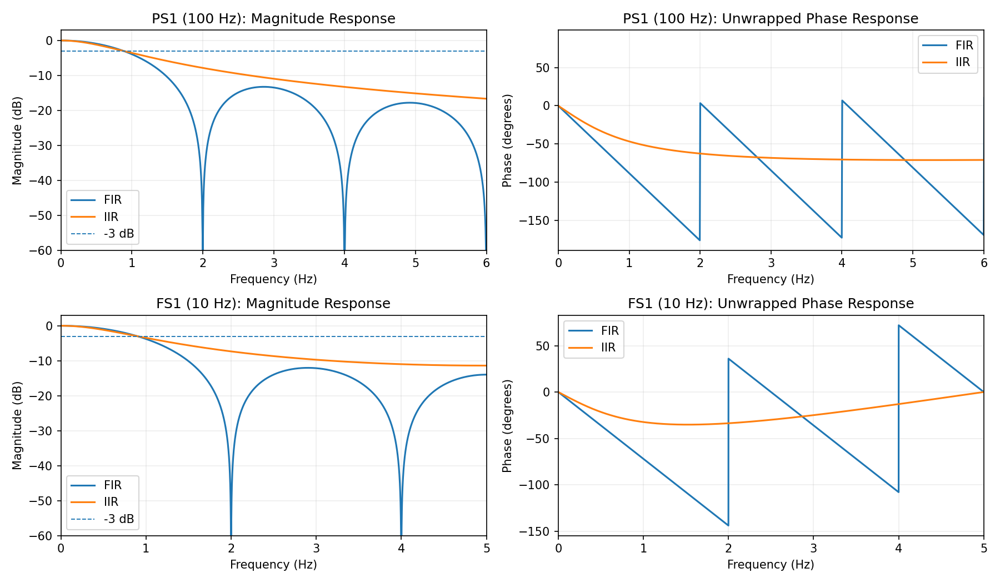
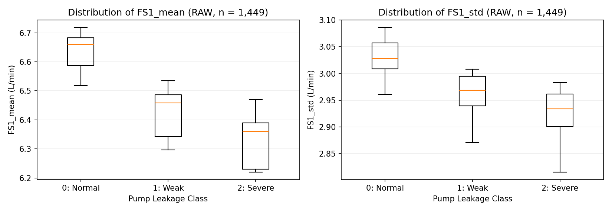
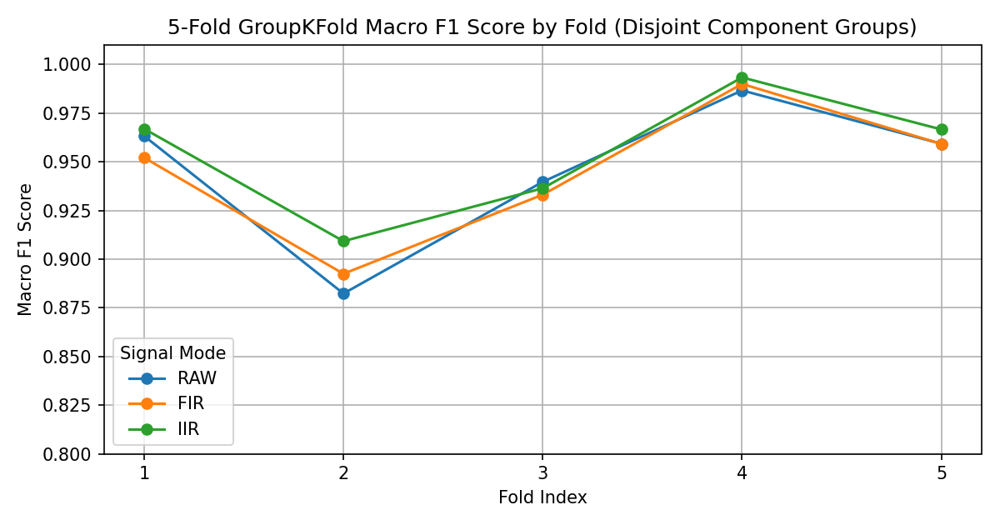
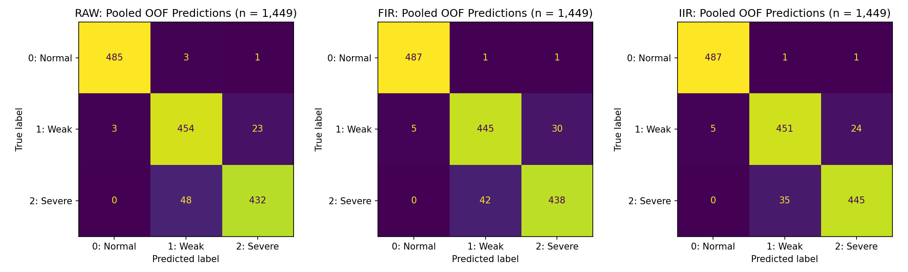
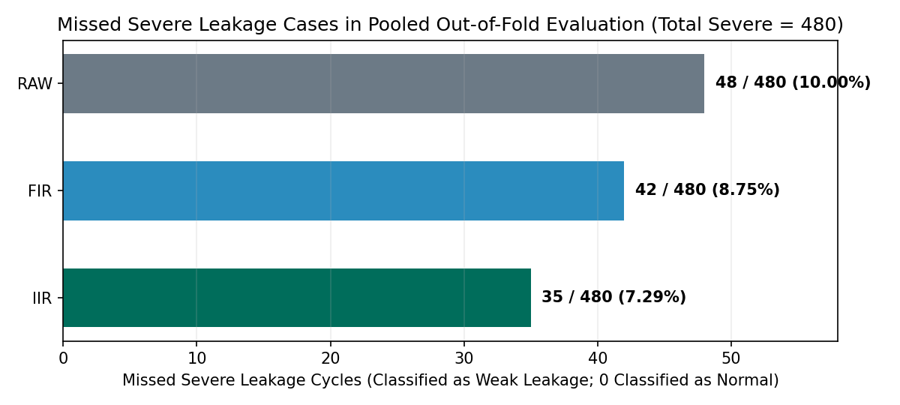
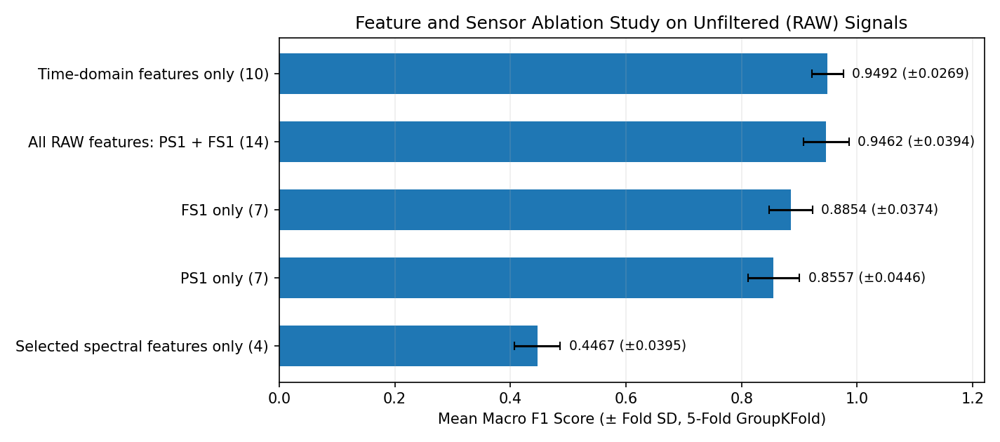
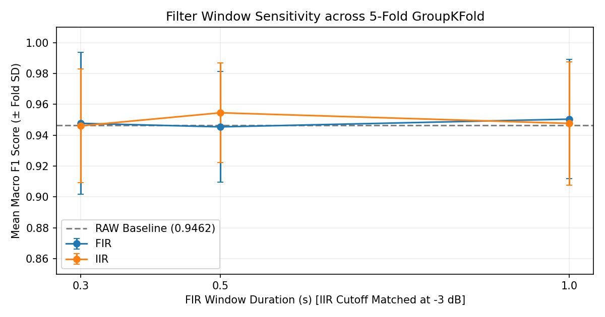

# Hydraulic Pump Leakage Detection Using Digital Signal Processing and Machine Learning

## 1. Project Overview

This repository evaluates whether causal digital low-pass filtering improves feature-based classification of internal hydraulic pump leakage on the UCI Condition Monitoring of Hydraulic Systems dataset. The pipeline compares three signal representations extracted from primary circuit pressure (`PS1`, 100 Hz) and volume flow (`FS1`, 10 Hz) recordings across 1,449 stable 60-second operating cycles:

- **RAW:** Unfiltered sensor recordings.
- **FIR:** Causal moving average filter ($0.5\text{ s}$ window).
- **IIR:** First-order causal exponential smoothing matched to the FIR $-3\text{ dB}$ cutoff frequency.

Each 60-second cycle is summarized into 14 time-domain and frequency-domain features (7 per sensor) and classified into three pump leakage states (`0`: normal, `1`: weak leakage, `2`: severe leakage) using a fixed Random Forest model evaluated under 5-fold `GroupKFold` cross-validation grouped by cooler, valve, and accumulator operating states.

Across the five grouped folds, first-order IIR smoothing achieved the highest mean Macro F1 score (`0.9545`, fold SD `0.0323`), compared with `0.9462` (`0.0394` SD) for RAW and `0.9454` (`0.0360` SD) for FIR. In pooled out-of-fold predictions across all 480 severe leakage cycles, IIR reduced missed severe cases from 48 (RAW) to 35 (a 27.1% relative reduction in missed severe cases), with every missed severe cycle classified as weak leakage rather than normal operation. However, IIR did not outperform RAW in every fold, severe-class precision remained slightly lower (`94.68%` for IIR vs. `94.74%` for RAW), and a feature ablation study on RAW signals showed that the 10 time-domain features alone reached a mean Macro F1 of `0.9492` (`0.0269` SD).

---

## 2. Research Question

Does applying a causal FIR moving average or first-order IIR low-pass filter to pressure and flow recordings produce features that classify hydraulic pump leakage more accurately than unfiltered signals under unseen combinations of auxiliary component states?

Signal smoothing reduces high-frequency fluctuations, but it also attenuates and delays rapid step transitions that may carry diagnostic information about internal pump wear. Rather than assuming preprocessing improves downstream classification, this study tests RAW, FIR, and IIR representations under identical feature definitions, classifier settings, and grouped validation splits.

---

## 3. Dataset and Sensors

The experiments use the **Condition Monitoring of Hydraulic Systems** dataset collected from a laboratory hydraulic test rig by ZeMA gGmbH and Saarland University ([DOI: 10.24432/C5CW21](https://doi.org/10.24432/C5CW21)). The rig repeats 60-second constant-load cycles while varying fault severity across four components: cooler, valve, internal pump leakage, and hydraulic accumulator.

### Sensor Subset

To keep the signal processing comparison controlled across two distinct sampling rates, the analysis uses two primary sensors out of the 17 channels available in the archive:

| Sensor File | Physical Quantity | Unit | Sampling Rate ($f_s$) | Nyquist Frequency | Samples per 60 s Cycle | Min Value | Max Value | NaN / Inf | Zero Proportion |
|---|---|---|---:|---:|---:|---:|---:|---:|---:|
| `PS1.txt` | Pressure sensor 1 | bar | 100 Hz ($\Delta t = 10\text{ ms}$) | 50 Hz | 6,000 | 133.13 | 191.92 | 0 / 0 | 0.0000 |
| `FS1.txt` | Volume flow sensor 1 | L/min | 10 Hz ($\Delta t = 100\text{ ms}$) | 5 Hz | 600 | 0.00 | 20.48 | 0 / 0 | 0.0565 |

Zero readings in `FS1.txt` (5.65% of samples) may reflect low-flow operating periods and are not automatically treated as missing values.

### Operating Cycles and Target Distribution

Each row in `PS1.txt`, `FS1.txt`, and `profile.txt` corresponds to one 60-second operating cycle. The dataset includes 2,205 total cycles, annotated with `stable_flag = 0` when static operating conditions were reached (1,449 cycles) and `stable_flag = 1` when static conditions might not yet have been reached (756 cycles).

| Pump Leakage Class | Label Code | All Cycles ($n = 2,205$) | Stable Cycles (`stable_flag = 0`, $n = 1,449$) | Unstable Cycles (`stable_flag = 1`, $n = 756$) |
|---|---:|---:|---:|---:|
| No leakage (Normal) | `0` | 1,221 | 489 | 732 |
| Weak leakage | `1` | 492 | 480 | 12 |
| Severe leakage | `2` | 492 | 480 | 12 |
| **Total** | | **2,205** | **1,449** | **756** |

The primary analysis uses the **1,449 stable cycles**, where the three pump leakage classes are nearly balanced (`489`, `480`, `480`). In the 756 unstable cycles, 96.8% of observations belong to class `0`. Filtering by `stable_flag == 0` is an explicit analytical scope choice rather than missing-data removal.



*Figure 1: Raw `PS1` (100 Hz) and `FS1` (10 Hz) recordings over a 60-second cycle for three pump leakage states under matched auxiliary component conditions (`cooler = 100%`, `valve = 100%`, `accumulator = 90 bar`).*

---

## 4. Experimental Methodology

1. **Data Integrity and Native Sampling Alignment:** `PS1` (6,000 samples/cycle) and `FS1` (600 samples/cycle) are audited for finite values and processed on their native time axes. Rather than interpolating `FS1` to 100 Hz or matching raw column indices (where sample index 100 corresponds to $1.0\text{ s}$ in `PS1` but $10.0\text{ s}$ in `FS1`), filtering and feature extraction run independently per sensor and join by `cycle_id`.
2. **Causal Cycle-Wise Filtering:** Each 60-second cycle is filtered independently along its time axis under three modes (`RAW`, `FIR`, `IIR`) without carrying filter state across cycle boundaries.
3. **Feature Extraction:** Seven features (five time-domain, two frequency-domain) are computed per sensor per cycle, yielding a $1,449 \times 14$ feature matrix for each signal mode.
4. **Group-Aware Validation:** A Random Forest classifier with fixed hyperparameters is evaluated first on an exploratory 80/20 `GroupShuffleSplit` holdout (38 training configuration groups, 10 test configuration groups) and then across a 5-fold `GroupKFold` scheme grouped by `(cooler, valve, accumulator)` states.
5. **Diagnostic Risk and Sensitivity Analysis:** Out-of-fold (OOF) predictions across all 1,449 cycles are pooled to inspect class confusion, missed severe leakage cases, feature/sensor ablation on RAW signals, filter window sensitivity (`0.3 s`, `0.5 s`, `1.0 s`), and hypothetical cost matrices.

---

## 5. Signal Processing Methods

The UCI dataset provides digitized sensor measurements; this study does not perform physical analog-to-digital conversion. Digital filters are applied to the discrete-time sequences $x[n]$ within each cycle. The transfer functions $H(z)$ below describe the designed digital filters, not the physical transfer function of the hydraulic test rig.

### FIR Moving Average Filter

The causal finite impulse response (FIR) filter averages the current sample and the preceding $L - 1$ samples:

$$y[n] = \frac{1}{L}\sum_{k=0}^{L-1} x[n - k], \qquad H_{\text{FIR}}(z) = \frac{1}{L}\sum_{k=0}^{L-1} z^{-k}$$

For a target smoothing window of $0.50\text{ s}$, the filter length is $L = \max(3, \text{round}(f_s \times 0.50))$, giving $L = 50$ samples for `PS1` (100 Hz) and $L = 5$ samples for `FS1` (10 Hz). Because all coefficients are finite and all poles lie at $z = 0$, the FIR filter is bounded-input bounded-output (BIBO) stable.

### First-Order IIR Exponential Smoothing Filter

The causal first-order infinite impulse response (IIR) filter updates the output recursively using feedback coefficient $\alpha$:

$$y[n] = (1 - \alpha)x[n] + \alpha y[n - 1], \qquad H_{\text{IIR}}(z) = \frac{1 - \alpha}{1 - \alpha z^{-1}}$$

To compare filter architectures fairly rather than picking arbitrary parameters, $\alpha$ is solved analytically so that the IIR filter matches the $-3\text{ dB}$ magnitude cutoff frequency $f_c$ of the corresponding FIR filter on each sensor ($\omega_c = 2\pi f_c / f_s$, $t = 2 - \cos\omega_c$, $\alpha = t - \sqrt{t^2 - 1}$):

| Sensor | Sampling Rate ($f_s$) | Window Duration | FIR Length ($L$) | Matched $-3\text{ dB}$ Cutoff ($f_c$) | IIR Coefficient / Pole ($\alpha$) | RMS Difference vs. RAW (Cycle #2190) |
|---|---:|---:|---:|---:|---:|---:|
| `PS1` | 100 Hz | 0.50 s | 50 samples | 0.8865 Hz | 0.945834 | 2.2728 bar (FIR) / 1.5487 bar (IIR) |
| `FS1` | 10 Hz | 0.50 s | 5 samples | 0.9016 Hz | 0.575832 | 0.9509 L/min (FIR) / 0.6046 L/min (IIR) |

Because $0 < \alpha < 1$ for both sensors, the single pole at $z = \alpha$ lies strictly inside the unit circle, guaranteeing BIBO stability.

### Boundary Initialization

Each cycle is filtered using `scipy.signal.lfilter` initialized with `scipy.signal.lfilter_zi(b, a)` scaled by the first sample $x[0]$ of that cycle. This steady-state initialization assumes a constant signal equal to $x[0]$ prior to $t = 0\text{ s}$, avoiding an artificial zero-startup jump at the beginning of each cycle without leaking information from adjacent cycles.



*Figure 2: Zoomed comparison of RAW, FIR, and IIR signals around the largest step transition in cycle #2190 (`9.46 s` for `PS1`, `9.50 s` for `FS1`). FIR exhibits a symmetric ramp delay over $L$ samples, whereas IIR responds immediately at the step onset and decays exponentially.*



*Figure 3: Magnitude (dB) and unwrapped phase (degrees) responses for the designed `PS1` and `FS1` filters computed via `scipy.signal.freqz`. FIR and IIR share the same $-3\text{ dB}$ cutoff frequency, while FIR introduces periodic spectral nulls at multiples of $f_s / L$ (2 Hz and 4 Hz).*

---

## 6. Feature Engineering

For each signal representation (`RAW`, `FIR`, `IIR`) and each sensor (`PS1`, `FS1`), seven summary features are extracted per 60-second cycle:

| Domain | Feature Name | Formula / Definition | Physical Interpretation |
|---|---|---|---|
| Time (1) | `{sensor}_mean` | $\frac{1}{N}\sum_{n=0}^{N-1} x[n]$ | Average pressure or flow level across the 60 s cycle |
| Time (2) | `{sensor}_std` | $\sqrt{\frac{1}{N}\sum_{n=0}^{N-1} (x[n] - \bar{x})^2}$ | Overall amplitude dispersion around the cycle mean |
| Time (3) | `{sensor}_rms` | $\sqrt{\frac{1}{N}\sum_{n=0}^{N-1} x[n]^2}$ | Root-mean-square signal magnitude |
| Time (4) | `{sensor}_p2p` | $\max(x) - \min(x)$ | Peak-to-peak dynamic range within the cycle |
| Time (5) | `{sensor}_diff_rms` | $\sqrt{\frac{1}{N-1}\sum_{n=0}^{N-2} (x[n+1] - x[n])^2}$ | RMS of sample-to-sample differences (captures step sharpness and high-frequency jitter) |
| Frequency (6) | `{sensor}_spectral_centroid_Hz` | $\frac{\sum_{f > 0} f \cdot P(f)}{\sum_{f > 0} P(f)}$ | Power-weighted mean frequency from Welch PSD (`detrend='constant'`) |
| Frequency (7) | `{sensor}_power_frac_ge2Hz` | $\frac{\sum_{f \ge 2\text{ Hz}} P(f)}{\sum_{f > 0} P(f)}$ | Fraction of non-DC Welch spectral power at or above 2.0 Hz |

Power spectral density $P(f)$ is estimated per cycle using Welch's method (`scipy.signal.welch`) with 4-second Hann segments (`nperseg = 400` for `PS1`, `40` for `FS1`), 50% overlap, and constant mean detrending. Combining 7 `PS1` features and 7 `FS1` features produces 14 features per cycle.



*Figure 4: Distributions of unfiltered `FS1_mean` and `FS1_std` across the three pump leakage classes ($n = 1,449$ stable cycles). Internal pump leakage reduces mean delivery flow and cycle standard deviation even before filtering.*

---

## 7. Model Validation

Operating cycles in the UCI dataset share combinations of cooler efficiency (`3%`, `20%`, `100%`), valve switching condition (`73%`, `80%`, `90%`, `100%`), and accumulator pressure (`90`, `100`, `115`, `130 bar`). Across the 1,449 stable cycles, there are 48 unique `cooler|valve|accumulator` configuration groups. Because cycles recorded under identical auxiliary component states exhibit similar pressure and flow profiles, random cycle-level splitting would place near-duplicate operating regimes in both training and test sets.

To prevent configuration-group leakage, validation uses `GroupKFold(n_splits=5)` keyed on the composite group string `cooler|valve|accumulator`:

- Every `cooler|valve|accumulator` configuration group appears in either the training set or the test set of a given fold, never both.
- All three signal representations (`RAW`, `FIR`, `IIR`), feature ablations, and filter window sensitivity runs use the exact same fold assignments.
- The classifier is fixed across all experiments: `RandomForestClassifier(n_estimators=100, min_samples_leaf=2, class_weight='balanced_subsample', random_state=42)` for 5-fold cross-validation (and `n_estimators=150` in the preliminary single-split holdout).
- No feature scaling, imputation, or hyperparameter tuning is fitted across the full dataset prior to splitting.

---

## 8. Results

### Primary 5-Fold GroupKFold Cross-Validation

Table 1 reports the mean and fold-to-fold standard deviation (SD) across the 5 disjoint configuration-group folds (from `results/cv_5fold_summary.csv` and `results/cv_5fold_per_fold.csv`):

| Method | Mean Macro F1 | Fold SD (Macro F1) | Mean Balanced Accuracy | Fold SD (Bal. Acc.) | Mean Recall Class 0 (Normal) | Mean Recall Class 1 (Weak) | Mean Recall Class 2 (Severe) |
|---|---:|---:|---:|---:|---:|---:|---:|
| **RAW** | 0.9462 | 0.0394 | 0.9465 | 0.0390 | 0.9915 | 0.9456 | 0.9024 |
| **FIR** ($0.5\text{ s}$) | 0.9454 | 0.0360 | 0.9456 | 0.0356 | 0.9960 | 0.9264 | 0.9144 |
| **IIR** ($0.5\text{ s}$) | **0.9545** | **0.0323** | **0.9547** | **0.0321** | **0.9960** | 0.9396 | **0.9287** |

### Fold-by-Fold Macro F1 Breakdown

| Fold | Train Cycles | Test Cycles | RAW Macro F1 | FIR Macro F1 | IIR Macro F1 | FIR vs. RAW | IIR vs. RAW |
|---:|---:|---:|---:|---:|---:|---:|---:|
| 1 | 1,170 | 279 | 0.9632 | 0.9521 | **0.9669** | -0.0111 | +0.0037 |
| 2 | 1,149 | 300 | 0.8823 | 0.8925 | **0.9092** | +0.0101 | +0.0269 |
| 3 | 1,149 | 300 | **0.9397** | 0.9331 | 0.9364 | -0.0066 | -0.0033 |
| 4 | 1,149 | 300 | 0.9867 | 0.9900 | **0.9933** | +0.0033 | +0.0067 |
| 5 | 1,179 | 270 | 0.9593 | 0.9592 | **0.9666** | -0.0001 | +0.0074 |
| **Mean** | | | **0.9462** | **0.9454** | **0.9545** | **-0.0009** | **+0.0083** |

Key observations from the fold-level metrics:

1. **Modest Mean Improvement with IIR:** IIR (`0.5 s` cutoff-matched) achieved a mean Macro F1 of `0.9545`, which is `0.83` percentage points (`+0.0083`) higher than RAW (`0.9462`), while FIR (`0.9454`) scored `0.08` percentage points (`-0.0009`) below RAW.
2. **Performance Varies by Fold and Split:** Fold-to-fold standard deviations (`3.23` to `3.94` percentage points) are four times larger than the `0.83` percentage point mean gap between IIR and RAW. In Fold 3, RAW (`0.9397`) outperformed both IIR (`0.9364`) and FIR (`0.9331`). Furthermore, in the initial exploratory single-split holdout (`GroupShuffleSplit`, 300 test cycles, `results/metrics_holdout.csv`), RAW achieved `0.9733` Macro F1 compared with `0.9633` for IIR and `0.9533` for FIR.
3. **No Claim of Statistical Significance:** Because the five cross-validation folds share overlapping training sets on a single laboratory rig, the 0.83 percentage point difference is reported as an empirical sample difference without formal significance claims.



*Figure 5: Macro F1 scores across the five disjoint component-configuration folds. Fold-level variation across operating regimes exceeds the difference between filtering methods within any single fold.*

---

## 9. Error Analysis

Mean cross-validation scores weight all three classes equally within each fold, which can obscure the direction of classification errors on severe pump leakage (class `2`). To inspect individual cycle errors, out-of-fold (OOF) predictions from the five test folds were pooled across all 1,449 stable cycles (`results/dsa_oof_predictions.csv`, `results/dsa_perclass_metrics.csv`, and `results/dsa_critical_errors.csv`).

*Note on metric aggregation:* Pooled OOF Macro F1 (`0.9459` for RAW, `0.9451` for FIR, `0.9542` for IIR) is computed over the combined $1,449$-cycle confusion matrix and differs slightly from the unweighted mean of the five per-fold Macro F1 scores (`0.9462`, `0.9454`, `0.9545`) because test fold sizes vary between 270 and 300 cycles.



*Figure 6: Pooled out-of-fold confusion matrices across all 1,449 stable cycles for RAW, FIR, and IIR representations.*

### Severe Leakage (`Class 2`) Diagnostic Performance

There are 480 actual severe leakage cycles in the stable subset. Table 2 summarizes the pooled out-of-fold results for class `2`:

| Method | Total Severe Cases | Correctly Identified Severe Cases | Missed Severe Cases | Severe Predicted as Weak (`2 -> 1`) | Severe Predicted as Normal (`2 -> 0`) | Pooled Severe Recall | Pooled Severe Precision | False Severe Predictions (`0/1 -> 2`) | Ordinal MAE | Pooled OOF Macro F1 |
|---|---:|---:|---:|---:|---:|---:|---:|---:|---:|---:|
| **RAW** | 480 | 432 | 48 | 48 | 0 | 90.00% | **94.74%** | 24 (1 from `0`, 23 from `1`) | 0.0545 | 0.9459 |
| **FIR** | 480 | 438 | 42 | 42 | 0 | 91.25% | 93.39% | 31 (1 from `0`, 30 from `1`) | 0.0552 | 0.9451 |
| **IIR** | 480 | **445** | **35** | **35** | **0** | **92.71%** | 94.68% | 25 (1 from `0`, 24 from `1`) | **0.0462** | **0.9542** |

1. **Reduction in Missed Severe Leakage:** Compared with RAW (48 missed severe cycles), FIR reduced missed severe cases to 42 (6 fewer misses, `-12.5%` relative reduction) and IIR reduced missed severe cases to 35 (13 fewer misses, `-27.1%` relative reduction).
2. **Boundary Confusion Between Weak and Severe Leakage:** Across all three representations, zero severe leakage cycles (`0 / 480`) were misclassified as normal (`class 0`). Every missed severe case was predicted as weak leakage (`class 1`).
3. **Precision-Recall Trade-off:** While IIR increased pooled severe-class recall from `90.00%` (`432 / 480`) to `92.71%` (`445 / 480`), false severe predictions increased by one cycle (from 24 in RAW to 25 in IIR), shifting severe-class precision from `94.74%` (`432 / 456`) to `94.68%` (`445 / 470`).



*Figure 7: Comparison of missed severe pump leakage cases out of 480 actual severe cycles in pooled out-of-fold evaluation.*

---

## 10. Ablation Study and Filter Window Sensitivity

### Feature and Sensor Ablation on RAW Signals

To determine which sensors and feature domains drive classification performance before any digital filtering is applied, an ablation study was conducted on the unfiltered (`RAW`) features using the same 5-fold `GroupKFold` splits (`results/ablation_summary.csv`):

| Feature Subset | Number of Features | Mean Macro F1 | Fold SD (Macro F1) | Mean Balanced Accuracy |
|---|---:|---:|---:|---:|
| **Time-domain features only (`PS1` + `FS1`)** | 10 | **0.9492** | **0.0269** | **0.9493** |
| **All RAW features (`PS1` + `FS1`)** | 14 | 0.9462 | 0.0394 | 0.9465 |
| **Flow sensor (`FS1`) only** | 7 | 0.8854 | 0.0374 | 0.8861 |
| **Pressure sensor (`PS1`) only** | 7 | 0.8557 | 0.0446 | 0.8560 |
| **Selected spectral features only (`PS1` + `FS1`)** | 4 | 0.4467 | 0.0395 | 0.4542 |

- **Complementary Sensors:** Combining pressure (`PS1`, `0.8557`) and volume flow (`FS1`, `0.8854`) improves mean Macro F1 by more than 6 percentage points over either sensor alone.
- **Time-Domain Dominance in This Feature Set:** Removing the four frequency-domain features (`spectral_centroid_Hz` and `power_frac_ge2Hz`) slightly improved RAW mean Macro F1 from `0.9462` to `0.9492` and reduced fold SD from `0.0394` to `0.0269`.
- **Scope of Spectral Findings:** The weak performance of the 4 spectral features (`0.4467`) reflects only the two coarse Welch summary statistics tested here on 60-second non-stationary load cycles; it does not imply that frequency-domain or time-frequency methods in general are uninformative for hydraulic fault diagnosis.



*Figure 8: Five-fold GroupKFold mean Macro F1 ($\pm 1\text{ SD}$) across sensor and feature-domain subsets on unfiltered signals.*

### Filter Window Sensitivity (`0.3 s`, `0.5 s`, `1.0 s`)

To evaluate sensitivity to smoothing duration, FIR and cutoff-matched IIR filters were tested across three window lengths (`0.3 s`, `0.5 s`, and `1.0 s`) on the same 5 folds (`results/sensitivity_summary.csv`):

| Window Duration | `PS1` FIR $L$ / IIR $\alpha$ | `FS1` FIR $L$ / IIR $\alpha$ | FIR Mean Macro F1 (SD) | IIR Mean Macro F1 (SD) |
|---:|---|---|---:|---:|
| **0.3 s** | $L = 30$, $\alpha = 0.9113$ ($f_c = 1.4786\text{ Hz}$) | $L = 3$, $\alpha = 0.4041$ ($f_c = 1.5529\text{ Hz}$) | 0.9477 (0.0460) | 0.9461 (0.0369) |
| **0.5 s** | $L = 50$, $\alpha = 0.9458$ ($f_c = 0.8865\text{ Hz}$) | $L = 5$, $\alpha = 0.5758$ ($f_c = 0.9016\text{ Hz}$) | 0.9454 (0.0360) | **0.9545 (0.0323)** |
| **1.0 s** | $L = 100$, $\alpha = 0.9725$ ($f_c = 0.4440\text{ Hz}$) | $L = 10$, $\alpha = 0.7575$ ($f_c = 0.4449\text{ Hz}$) | 0.9504 (0.0387) | 0.9476 (0.0400) |

The ranking between FIR and IIR reverses across window sizes: FIR slightly leads IIR at `0.3 s` (`0.9477` vs. `0.9461`) and `1.0 s` (`0.9504` vs. `0.9476`), whereas IIR peaks at `0.5 s` (`0.9545`).



*Figure 9: Mean Macro F1 ($\pm 1\text{ SD}$) across filter window durations (`0.3 s`, `0.5 s`, `1.0 s`) compared against the unfiltered baseline.*

---

## 11. Limitations

1. **Single Laboratory Test Rig:** All 2,205 cycles originate from one controlled hydraulic test bench. Grouped cross-validation across `(cooler, valve, accumulator)` states tests generalization to unseen component-state combinations on the same machine, not generalization across different physical pumps, fluid viscosities, or industrial installations.
2. **Restriction to Stable Operating Cycles:** The analysis evaluates the 1,449 cycles with `stable_flag = 0`. Performance on the 756 non-steady cycles (`stable_flag = 1`, which are heavily skewed toward class `0`) is not established by these benchmarks.
3. **Exploratory Filter Window Comparison on Validation Folds:** While the primary `0.5 s` window was specified as the baseline design in experiment `E2`, comparing `0.3 s`, `0.5 s`, and `1.0 s` on the same 5 cross-validation folds (`E4c`) without an outer nested test split means that post-hoc selection of the `0.5 s` IIR setting can introduce optimistic selection bias.
4. **Cycle-Level Batch Evaluation, Not Real-Time Deployment:** Each prediction requires a complete 60-second load cycle (6,000 `PS1` samples and 600 `FS1` samples). Latency, streaming buffer management, sensor drift, and hardware resource constraints were not tested.
5. **Hypothetical Cost Matrices:** The cost-sensitive evaluation in notebook section `E8` (`results/dsa_cost_scenarios.csv`) uses illustrative penalty weights rather than measured maintenance or downtime costs.

---

## 12. Reproduction Instructions

### 1. Clone the Repository and Install Dependencies

Requires Python 3.10+ (verified on Python 3.11.8).

```bash
git clone <repository-url>
cd hydraulic-pump-fault-detection-github
python -m venv .venv
```

Activate the virtual environment:

- **Windows (PowerShell):**
  ```powershell
  .\.venv\Scripts\Activate.ps1
  ```
- **Linux / macOS:**
  ```bash
  source .venv/bin/activate
  ```

Install the required packages:

```bash
pip install -r requirements.txt
```

### 2. Download and Place the UCI Dataset Files

Follow the instructions in [`DATASET.md`](DATASET.md):

1. Download the [UCI Condition Monitoring of Hydraulic Systems archive](https://archive.ics.uci.edu/dataset/447/condition+monitoring+of+hydraulic+systems) ([DOI: 10.24432/C5CW21](https://doi.org/10.24432/C5CW21)).
2. Extract `PS1.txt`, `FS1.txt`, and `profile.txt` into a `data/` folder at the root of this repository:

```text
hydraulic-pump-fault-detection-github/
└── data/
    ├── PS1.txt
    ├── FS1.txt
    └── profile.txt
```

### 3. Run the Experiment Notebook

Launch Jupyter Lab or Jupyter Notebook from the repository root:

```bash
jupyter lab notebooks/P10_Hydraulic_DSA_Evaluasi_Risiko.ipynb
```

Run all cells sequentially from top to bottom (`Kernel -> Restart Kernel and Run All Cells`). Execution takes approximately 15 to 30 seconds on a modern multi-core CPU and requires around 500 MB of available RAM. All summary tables and out-of-fold predictions are exported automatically to `results/`.

---

## 13. Project Structure

```text
hydraulic-pump-fault-detection-github/
├── README.md                                           # Project documentation and experimental findings
├── DATASET.md                                          # UCI dataset provenance, schema, and setup instructions
├── requirements.txt                                    # Python package dependencies
├── .gitignore                                          # Excludes raw data files, virtual environments, and caches
├── notebooks/
│   └── P10_Hydraulic_DSA_Evaluasi_Risiko.ipynb         # Complete verified experiment notebook (E1 through E10)
├── figures/
│   ├── 01_sensor_waveforms_by_leakage_class.png        # Raw PS1 and FS1 traces across leakage classes
│   ├── 02_transient_response_raw_fir_iir.png           # Zoomed transient step response (RAW vs. FIR vs. IIR)
│   ├── 03_filter_frequency_response.png                # Magnitude and phase responses of FIR and IIR filters
│   ├── 04_feature_distributions_fs1_raw.png            # Boxplots of FS1_mean and FS1_std by leakage class
│   ├── 05_cv_5fold_macro_f1_by_fold.png                # 5-fold GroupKFold Macro F1 across folds
│   ├── 06_oof_confusion_matrices.png                   # Pooled out-of-fold confusion matrices (n = 1,449)
│   ├── 07_severe_leakage_missed_cases.png              # Missed severe leakage cases comparison (n = 480)
│   ├── 08_ablation_study_raw_features.png              # Sensor and feature-domain ablation study on RAW signals
│   └── 09_filter_window_sensitivity.png                # Filter window sensitivity (0.3 s, 0.5 s, 1.0 s)
├── results/
│   ├── quality_check.csv                               # Sensor dimension, range, NaN/Inf, and zero-value audit
│   ├── split_profile_holdout.csv                       # Cycle-level train/test assignment for exploratory holdout
│   ├── metrics_holdout.csv                             # Exploratory single GroupShuffleSplit holdout metrics
│   ├── cv_5fold_per_fold.csv                           # Per-fold 5-fold GroupKFold metrics for RAW, FIR, and IIR
│   ├── cv_5fold_summary.csv                            # Mean and SD of 5-fold GroupKFold metrics
│   ├── ablation_per_fold.csv                           # Per-fold metrics for RAW sensor and feature-domain subsets
│   ├── ablation_summary.csv                            # Summary table for RAW ablation study
│   ├── sensitivity_per_fold.csv                        # Per-fold metrics across 0.3 s, 0.5 s, and 1.0 s windows
│   ├── sensitivity_summary.csv                         # Summary table for filter window sensitivity
│   ├── dsa_oof_predictions.csv                         # Cycle-level out-of-fold predictions and class-2 probabilities
│   ├── dsa_perclass_metrics.csv                        # Pooled out-of-fold precision, recall, F1, and support per class
│   ├── dsa_critical_errors.csv                         # Severe leakage miss counts, ordinal MAE, and pooled Macro F1
│   └── dsa_cost_scenarios.csv                          # Hypothetical cost-matrix evaluation on OOF predictions
└── docs/
    ├── Hydraulic_Pump_Leakage_Detection_Portfolio.pdf  # 18-slide English portfolio presentation (PDF)
    └── Hydraulic_Pump_Leakage_Detection.pptx           # 18-slide English portfolio presentation (PowerPoint)
```

---

## 14. References

1. Helwig, N., Pignanelli, E., & Schütze, A. (2015). *Condition Monitoring of Hydraulic Systems* [Dataset]. UCI Machine Learning Repository. https://doi.org/10.24432/C5CW21
2. Helwig, N., Pignanelli, E., & Schütze, A. (2015). Condition Monitoring of a Complex Hydraulic System Using Multivariate Statistics. *2015 IEEE International Instrumentation and Measurement Technology Conference (I2MTC)*, Pisa, Italy, pp. 210-215. https://doi.org/10.1109/I2MTC.2015.7151267
3. Helwig, N., & Schütze, A. (2015). Detecting and compensating sensor faults in a hydraulic condition monitoring system. *Proceedings of SENSOR 2015*, Nuremberg, Germany, pp. 641-646. https://doi.org/10.5162/sensor2015/D8.1
4. Schneider, T., Helwig, N., & Schütze, A. (2017). Automatic feature extraction and selection for classification of cyclical time series data. *tm - Technisches Messen*, 84(3), 198-206. https://doi.org/10.1515/teme-2016-0072
5. Virtanen, P., et al. (2020). SciPy 1.0: Fundamental Algorithms for Scientific Computing in Python (`scipy.signal.lfilter`, `lfilter_zi`, `freqz`, `welch`). *Nature Methods*, 17, 261-272. https://docs.scipy.org/doc/scipy/reference/signal.html
6. Pedregosa, F., et al. (2011). Scikit-learn: Machine Learning in Python (`GroupKFold`, `GroupShuffleSplit`, `RandomForestClassifier`). *Journal of Machine Learning Research*, 12, 2825-2830. https://scikit-learn.org/stable/

